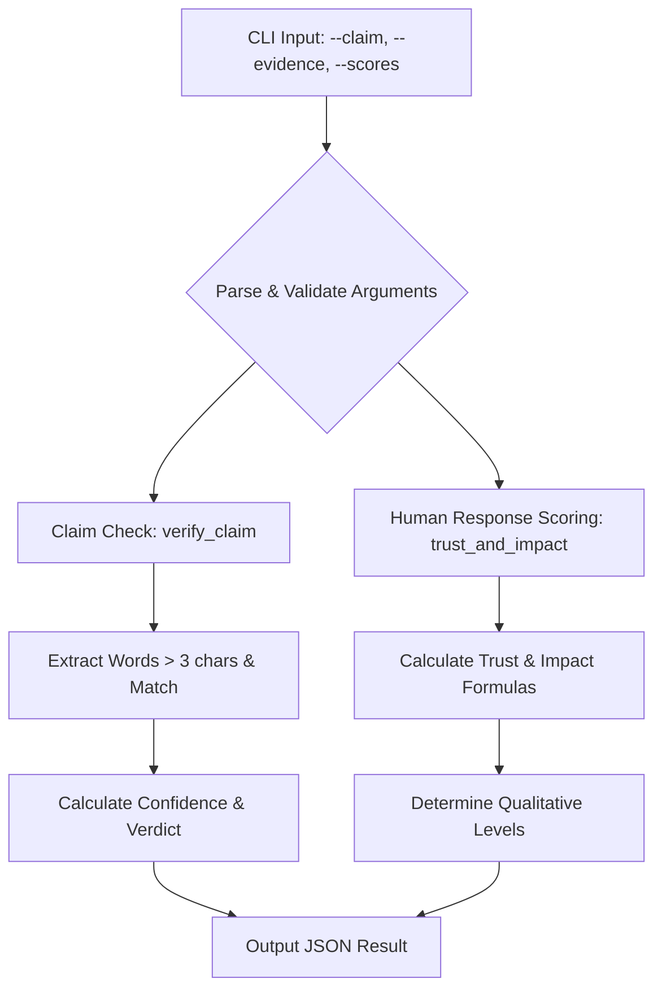

# Content Verification Tool

A lightweight command-line tool written in Python that provides two basic analytical checks for text content:
1. **Claim Verification:** Compares a claim against supplied evidence using keyword matching.
2. **Human Response Scoring:** Computes trust and impact metrics based on AI-generation, belief, and dissemination scores.

---

## 1. What This Project Does

This project provides a simple CLI utility to evaluate claims against text evidence and calculate trust and impact scores.

### Problems It Solves
- Quickly checks whether text evidence snippets share common keywords with a given claim to find supporting context.
- Calculates basic trust and potential impact levels from numerical scores representing how AI-generated content appears, how believable it is, and how likely it is to spread.

### Important Limitations
- **Not Real AI/ML:** The claim checker uses crude keyword matching (words longer than 3 characters) rather than semantic understanding or factual verification.
- **No Contradiction Detection:** Sharing words results in a positive match (`supported`), even if the evidence contradicts the claim.
- **Rule-Based Formulas:** Trust and impact levels are calculated using arithmetic differences/sums against fixed thresholds rather than real-world machine learning models.

---

## 2. How It Works

The application runs via a command-line interface (`main.py`) using Python's standard library (`argparse` and `json`). 

1. **Input Parsing:** Receives a `--claim`, zero or more `--evidence` snippets, and optional `--scores`.
2. **Claim Check (`verify_claim`):**
   - **Stop-Words Filtering:** Punctuation is stripped and high-frequency English function words (`STOP_WORDS`, e.g., "the", "and", "that", "is", "for") are eliminated, ensuring matching operates on informative content terms.
   - **Keyword Matching:** Identifies which evidence snippets share content keywords with the claim.
   - **Negation Detection:** Checks cited evidence snippets for negation and refutation markers (`NEGATION`, e.g., "no", "not", "never", "false", "debunked", "refuted", "fake").
   - **Confidence & Verdict Determination:**
     - `unverifiable`: No evidence snippets shared content keywords with the claim (0 citations, confidence = 0.0).
     - `contradicted`: Matching evidence contains negation cues, signaling that the evidence directly refutes the claim (confidence downgraded by 0.4).
     - `uncertain`: Exactly 1 evidence snippet matched without negation cues (confidence = 0.5, below the 0.6 threshold).
     - `supported`: Two or more evidence snippets matched without negation cues (confidence >= 0.7; formula: `min(0.9, 0.3 + 0.2 * count)`).
     - The formula min(0.9, 0.3 + 0.2 * count) calculates the confidence score for a supported claim based on the number of matching evidence snippets:
        1. Base Confidence (0.3): The starting confidence score when at least one evidence snippet matches.
        2. Incremental Scaling (+ 0.2 * count): Adds 0.2 confidence for every matching evidence snippet.
        3. Ceiling Cap (min(0.9, ...)): Caps the maximum confidence at 0.9 so keyword overlap alone never claims absolute (100%) certainty.

3. **Human Response Scoring (`trust_and_impact`):**
   - Validates that all three input scores are between `0` and `1`:
     - **AIGC:** Perceived likelihood of AI generation / synthetic markers.
     - **Belief:** Perceived audience credibility / acceptance.
     - **Dissemination:** Likelihood of viral resharing / amplification.
   - Calculates `trust` (`round(belief - aigc, 6)`) and `impact` (`round(belief + dissemination, 6)`).
   - Assigns qualitative classifications (`high_trust`, `moderate_trust`, `low_trust`, `suspicious`, `viral_risk`, `high_impact`, `moderate_impact`, `low_impact`).
   - **Trust Classifications (`trust_level`):**
     1. `suspicious`: Triggered when `aigc >= 0.7` and `belief >= 0.7`, indicating highly convincing synthetic content.
     2. `high_trust`: Net trust (`belief - aigc`) is `>= 0.5`.
     3. `moderate_trust`: Net trust is `>= 0` and `< 0.5`.
     4. `low_trust`: Net trust is `< 0`, meaning perceived AIGC outweighs audience belief.
   - **Impact Classifications (`impact_level`):**
     1. `viral_risk`: Triggered when `belief >= 0.7` and `dissemination >= 0.7`, indicating high belief and shareability.
     2. `high_impact`: Total impact (`belief + dissemination`) is `>= 1.3`, unless already classified as `viral_risk`.
     3. `moderate_impact`: Total impact is `>= 0.7` and `< 1.3`.
     4. `low_impact`: Total impact is `< 0.7`.

The demo shows that truth value and virality/trust often diverge in AI-era media:

| Scenario | Claim Verdict | Human Response | Real-World Meaning |
| --- | --- | --- | --- |
| Grounded Truth | supported | high_trust / high_impact | Legitimate, verifiable news accepted by the public. |
| Plausible Synthetic Viral | uncertain or supported | suspicious / viral_risk | AI-generated content (e.g., deepfakes, hyper-realistic AI leaks) that spreads rapidly despite synthetic markers. |
| Distrusted Fact | supported | low_trust | True claims that audiences reject because they look synthetic or counterintuitive. |
| Benign Hallucination | unverifiable | low_trust / low_impact | Obvious falsehoods or noise that fail verification and fail to gain audience traction. |

---

## 3. Mermaid Diagram



---

## 4. Repository Structure

```text
multimodal-content-verification/
├── main.py            # Main command-line script containing verification and scoring logic
├── requirements.txt   # Project dependencies (pytest for testing)
├── pytest.ini         # Configuration settings for pytest
└── tests/
    └── test_main.py   # Unit tests verifying claim matching and scoring formulas
```

---

## 5. Setup

### Prerequisites
- Python 3.8 or higher installed on your system.

### Installation Steps

1. Clone or open the repository directory:
   ```bash
   cd multimodal-content-verification
   ```

2. Create a Python virtual environment:
   ```bash
   python3 -m venv venv
   ```

3. Activate the virtual environment:
   - On macOS/Linux:
     ```bash
     source venv/bin/activate
     ```
   - On Windows (Command Prompt):
     ```cmd
     venv\Scripts\activate.bat
     ```

4. Install dependencies:
   ```bash
   pip install -r requirements.txt
   ```

---

## 6. How to Run the Project

### Simplest Working Command (Claim Check Only)
```bash
python3 main.py --claim "The photo was taken at the summit" --evidence "Summit photo taken Monday" --evidence "Photo taken at dawn"
```

### CLI Arguments
- `--claim`: The statement or claim text you want to check (required, 1 to 500 characters).
- `--evidence`: Supporting evidence text snippet. You can pass this argument multiple times to supply multiple pieces of evidence (optional).
- `--scores`: Three floating-point numbers between `0` and `1` representing `AIGC` (how AI-generated it looks), `BELIEF` (how believed it is), and `DISSEMINATION` (how likely to be shared) respectively (optional).

### Comprehensive Example with Scores
```bash
python3 main.py --claim "The photo was taken at the summit" \
    --evidence "Summit photo taken Monday" \
    --evidence "Photo taken at dawn" \
    --scores 0.2 0.8 0.8
```

### Example Output Meaning
```json
{
  "claim_check": {
    "verdict": "supported",
    "confidence": 0.7,
    "cited_evidence": [
      "ev_0",
      "ev_1"
    ],
    "evidence": {
      "ev_0": "Summit photo taken Monday",
      "ev_1": "Photo taken at dawn"
    }
  },
  "human_response": {
    "trust": 0.6,
    "trust_level": "high_trust",
    "impact": 1.4,
    "impact_level": "viral_risk"
  }
}
```
- **`verdict`**: Set to `supported` because multiple evidence snippets shared matching words with the claim.
- **`confidence`**: Calculated confidence level (e.g., `0.7`).
- **`cited_evidence`**: IDs of evidence snippets that matched (`ev_0`, `ev_1`).
- **`trust` / `impact`**: Numerical calculations derived from the input scores.
- **`trust_level` / `impact_level`**: Qualitative labels categorized by threshold rules.

---

## 7. How to Run the Tests

Run the test suite using `pytest`:
```bash
pytest
```

### What the Tests Verify
- **Claim Verification (`tests/test_main.py`):** Checks that zero evidence yields `unverifiable`, single matches yield `uncertain`, multiple matches yield `supported`, valid evidence IDs are cited, and blank or overly long claims are rejected with a `ValueError`.
- **Scoring Formulas:** Verifies correct calculations for trust and impact, boundary limits (rejection of scores outside `0` to `1`), and threshold classifications (e.g., suspicious/viral risk flags).

---

## 8. Current Limitations

- **Keyword Matching Limitation:** Uses basic word intersection (`len(w) > 3`), meaning words with different contexts or negations may trigger a positive match.
- **No Factual Ground Truth:** The tool does not connect to external databases, search engines, or real-world knowledge bases.
- **Synthetic Scoring:** Human response metrics are purely arithmetic formulas and threshold rules, not actual telemetry or human survey data.

---

## 9. Running the Interactive UI Demo (React + FastAPI)

This repository includes a modern React + TypeScript frontend and a FastAPI backend for interactive web demonstrations.

### Starting the Backend API
```bash
python3 -m uvicorn backend.server:app --reload --port 8000
```

### Starting the Frontend Dev Server
In a separate terminal window:
```bash
cd frontend
npm install
npm run dev
```
Then open `http://localhost:5173` in your browser to use the interactive UI dashboard.

