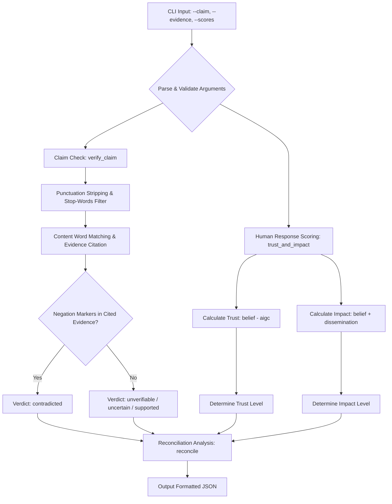

# Content Verification Tool

A lightweight analytical tool written in Python that provides three core capabilities for multimodal text and media verification:
1. **Claim Verification with Stop-Words Filtering & Negation Detection:** Compares a claim against supplied evidence using lexical matching, filtering non-informative stop words and detecting contradiction cues.
2. **Human Response Scoring:** Computes trust and viral impact metrics based on perceived AI-generation, audience belief, and dissemination likelihood.
3. **Reconciliation Analysis:** Reconciles factual evidence grounding against human perception metrics to flag critical online misinformation risks and public trust disconnects.

---

## 1. What This Project Does

This project provides a CLI utility (`main.py`) and web dashboard to evaluate claims against text evidence snippets and calculate human response metrics.

### Problems It Solves
- Filters grammatical noise and checks whether text evidence snippets share salient content words with a given claim.
- Detects negation/debunking markers in evidence to identify contradictions rather than blindly treating shared words as support.
- Calculates audience trust and viral impact levels from numerical indicators representing perceived AI-generation, audience credibility, and sharing likelihood.
- Reconciles fact-checking results with public perception to distinguish benign hallucinations, grounded facts, debunked claims, and high-risk viral synthetic misinformation.

### Practical Scope & Boundaries
- **Lexical Matching with Heuristics:** The claim checker uses case-insensitive word tokenization, punctuation stripping, stop-word removal, and negation cues. Production systems typically layer dense embeddings and neural Natural Language Inference (NLI) on top of this lexical foundation.
- **Rule-Based Heuristic Scoring:** Trust, impact, and reconciliation levels are computed from calibrated mathematical formulas and thresholds, mirroring production risk-scoring matrices.

---

## 2. How It Works

The application runs via a command-line interface (`main.py`) using Python's standard library (`argparse` and `json`).

1. **Input Parsing:** Receives a `--claim`, zero or more `--evidence` snippets, and optional `--scores`.
2. **Claim Check (`verify_claim`):**
   - **Stop-Words Filtering:** Punctuation is stripped and high-frequency English function words (`STOP_WORDS`, e.g., "the", "and", "that", "is", "for") are eliminated, ensuring matching operates on informative content terms.
   - **Keyword Matching:** Identifies which evidence snippets share content keywords with the claim.
   - **Negation Detection:** Checks cited evidence snippets for negation and refutation markers (`NEGATION`, e.g., "no", "not", "never", "false", "debunked", "refuted", "fake").
   - **Confidence & Verdict Determination:**
     - `unverifiable`: No evidence snippets shared content keywords with the claim (0 citations, confidence = 0.0).
     - `contradicted`: Matching evidence contains negation cues, signaling that the evidence directly refutes the claim (confidence downgraded by 0.4).
     - `uncertain`: Exactly 1 evidence snippet matched without negation cues (confidence = 0.5, below the 0.6 threshold).
     - `supported`: Two or more evidence snippets matched without negation cues (confidence >= 0.7; formula: `min(0.9, 0.3 + 0.2 * count)`).

3. **Human Response Scoring (`trust_and_impact`):**
   - Validates that all three input scores are between `0` and `1`:
     - **AIGC:** Perceived likelihood of AI generation / synthetic markers.
     - **Belief:** Perceived audience credibility / acceptance.
     - **Dissemination:** Likelihood of viral resharing / amplification.
   - Calculates `trust` (`round(belief - aigc, 6)`) and `impact` (`round(belief + dissemination, 6)`).
   - Assigns qualitative classifications (`high_trust`, `moderate_trust`, `low_trust`, `suspicious`, `viral_risk`, `high_impact`, `moderate_impact`, `low_impact`).

4. **Reconciliation Analysis (`reconcile`):**
   - Combines objective claim verification (`verdict`) with subjective human response (`trust_level`, `impact_level`) to classify the content into real-world operational categories:
     - `viral_misinformation`: Contradicted claim that still enjoys high audience trust or viral dissemination.
     - `dangerous_disconnect`: Factual, supported claim that audiences distrust (*Liar's Dividend*).
     - `plausible_synthetic_viral`: Highly shared or believed synthetic content requiring immediate scrutiny.
     - `grounded_truth`: Supported claim with healthy audience trust.
     - `debunked`: Contradicted claim that audiences recognize as untrustworthy.
     - `benign_hallucination`: Unverifiable claim with low impact and low trust.
     - `unverified`: Ambiguous content without strong viral or debunking signals.

5. **Output:** Formats and prints a JSON object containing `claim_check`, `human_response`, and `reconciliation`.

### Risk & Reconciliation Matrix

| Scenario | Claim Verdict | Human Response | Reconciliation Status | Real-World Meaning |
| --- | --- | --- | --- | --- |
| **Grounded Truth** | supported | high_trust / moderate_trust | `grounded_truth` | Legitimate, verifiable news accepted by the public. |
| **Plausible Synthetic Viral** | supported / uncertain | suspicious / viral_risk | `plausible_synthetic_viral` | Believable synthetic media (e.g., hyper-realistic AI deepfakes) spreading rapidly. |
| **Distrusted Fact** | supported | low_trust | `dangerous_disconnect` | Factual events rejected by the public because they look synthetic or counterintuitive. |
| **Viral Misinformation** | contradicted | suspicious / viral_risk / high_trust | `viral_misinformation` | Refuted/debunked claims actively believed or spreading virally. |
| **Contained Debunk** | contradicted | low_trust | `debunked` | Falsehoods that evidence disproves and the audience correctly rejects. |
| **Benign Hallucination** | unverifiable | low_impact / low_trust | `benign_hallucination` | Low-impact AI hallucinations or unverified noise failing to gain traction. |

---

## 3. Mermaid Diagram



---

## 4. Real-World Techniques & Practices in Online AIGC Detection

The three features in `main.py`—**Reconciliation of Human Response & Claim Verification**, **Stop-Words Mechanism**, and **Negation Handling**—directly reflect core methodologies employed by modern production content-moderation systems, fact-checking networks (e.g., IFCN, Full Fact), and online platform trust & safety architectures (e.g., Meta, Google, X).

### 1. Reconciliation of Human Response & Claim Verification (Multi-Dimensional Risk Triaging)
* **The Decoupling of Veracity and Virality:** In contemporary online ecosystems, factual truth and viral spread frequently diverge. Highly fabricated AI-generated content (e.g., synthetic audio leaks, deepfaked crisis footage, or sensational visual hoaxes) often achieves explosive dissemination because it triggers emotional responses, outrage, or confirmation bias. Conversely, genuine, unedited footage of unusual real-world events is increasingly dismissed by cynical audiences as "AI-generated" or "CGI" (the *Liar's Dividend*).
* **Production Practice:** Production trust & safety pipelines never treat fact-checking or AI detection as isolated, 1-dimensional scores. Major platforms and moderation consortia prioritize content through a **2D risk matrix**:
  - `viral_misinformation` (`contradicted` claim + `viral_risk` / `suspicious`): Immediate high-severity escalation. Triggers algorithmic downranking, emergency interstitial warning banners, search deprecation, and high-priority human investigator review.
  - `dangerous_disconnect` (`supported` claim + `low_trust`): Represents truth decay and public skepticism of verified facts. Platforms counter this not through takedowns, but with authoritative contextual panels, verifiable provenance metadata (e.g., C2PA Content Credentials), and institutional fact-check citations.
  - `plausible_synthetic_viral` (`supported`/`uncertain` + `suspicious`/`viral_risk`): Captures synthetic media that conveys real-world events (e.g., AI-generated re-enactments or summaries). Platforms flag these for synthetic disclosure watermarking without de-platforming.
  - `benign_hallucination` (`unverifiable` + `low_impact`): Low-priority noise. Automations avoid wasting human fact-checking bandwidth on zero-engagement AI nonsense.

### 2. Stop-Words Mechanism (Lexical Noise Reduction & Salience Filtering)
* **The Problem in Text Alignment:** Under Zipf’s Law, high-frequency grammatical words (articles, prepositions, auxiliary verbs such as "the", "and", "that", "is", "for") account for the vast majority of tokens in natural language. In unigram overlap matching, two completely disparate sentences (e.g., *"The image of the summit was taken on Monday"* vs. *"That is the picture from the conference"*) produce false-positive alignments simply due to shared grammatical scaffolding.
* **Production Practice:** Real-world verification pipelines—including sparse retrieval engines (Elasticsearch, BM25), dense embedding tokenizers, and retrieval-augmented generation (RAG) fact-checkers—perform **lexical stop-word filtering and vocabulary sanitation**:
  - Eliminating high-frequency closed-class words forces alignment to depend strictly on high-entropy semantic content keywords (proper nouns, action verbs, dates, and locations).
  - In retrieval-augmented fact verification, query sanitization and stop-word pruning drastically improve precision@k during the initial retrieval pass before computationally expensive cross-encoders or Large Language Models (LLMs) re-rank evidence.

### 3. Negation Handling Mechanism (Polarity Inversion & Debunk Detection)
* **The Problem with Bag-of-Words Matching:** A notorious failure mode of standard semantic retrieval and keyword matching is **polarity reversal**. The claim *"The photo is genuine"* and the debunk snippet *"This photo is not genuine; it is a fake and has been refuted"* share almost identical keywords (*photo*, *genuine*). A naive verification model rewards high token overlap and erroneously marks the claim as "supported" by the very article that disproved it.
* **Production Practice:** In automated fact-checking and automated claim stance detection:
  - **Refutation & Debunk Filtering:** Fact-checking repositories (e.g., Snopes, PolitiFact, ClaimReview schema datasets) often quote the false claim verbatim in their headline alongside explicit refutation markers ("false", "debunked", "not true"). Detection of negation tokens (`not`, `never`, `false`, `debunked`, `refuted`, `fake`) is essential to flip the stance from entailment (`supported`) to refutation (`contradicted`).
  - **Heuristic-to-Neural Pipeline:** Rule-based negation cue detection serves as an immediate, zero-latency safety guardrail in offline and online stream processing. In full-scale systems, this heuristic complements Natural Language Inference (NLI) models trained specifically to distinguish contradiction from neutral and entailment relationships.

---

## 5. Repository Structure

```text
multimodal-content-verification/
├── main.py            # Main command-line script containing verification, scoring, and reconciliation logic
├── backend/
│   └── server.py      # FastAPI backend exposing /api/verify and /api/health
├── frontend/          # React + TypeScript dashboard with Vite
├── requirements.txt   # Project dependencies (pytest, fastapi, uvicorn)
├── pytest.ini         # Configuration settings for pytest
└── tests/
    └── test_main.py   # Unit & end-to-end tests verifying claim matching, scoring, and reconciliation
```

---

## 6. Setup

### Prerequisites
- Python 3.8 or higher installed on your system.

### Installation Steps

1. Clone or open the repository directory:
   ```bash
   cd multimodal-content-verification
   ```

2. Create a Python virtual environment:
   ```bash
   python3 -m venv venv
   ```

3. Activate the virtual environment:
   - On macOS/Linux:
     ```bash
     source venv/bin/activate
     ```
   - On Windows (Command Prompt):
     ```cmd
     venv\Scripts\activate.bat
     ```

4. Install dependencies:
   ```bash
   pip install -r requirements.txt
   ```

---

## 7. How to Run the Project

### Simplest Working Command (Claim Check Only)
```bash
python3 main.py --claim "The photo was taken at the summit" --evidence "Summit photo taken Monday" --evidence "Photo taken at dawn"
```

### CLI Arguments
- `--claim`: The statement or claim text you want to check (required, 1 to 500 characters).
- `--evidence`: Supporting evidence text snippet. You can pass this argument multiple times to supply multiple pieces of evidence (optional).
- `--scores`: Three floating-point numbers between `0` and `1` representing `AIGC` (how AI-generated it looks), `BELIEF` (how believed it is), and `DISSEMINATION` (how likely to be shared) respectively (optional).

### Comprehensive Example with Scores
```bash
python3 main.py --claim "The photo was taken at the summit" \
    --evidence "Summit photo taken Monday" \
    --evidence "Photo taken at dawn" \
    --scores 0.2 0.8 0.8
```

### Example Output Meaning
```json
{
  "claim_check": {
    "verdict": "supported",
    "confidence": 0.7,
    "cited_evidence": [
      "ev_0",
      "ev_1"
    ],
    "evidence": {
      "ev_0": "Summit photo taken Monday",
      "ev_1": "Photo taken at dawn"
    }
  },
  "human_response": {
    "trust": 0.6,
    "trust_level": "high_trust",
    "impact": 1.6,
    "impact_level": "viral_risk"
  },
  "reconciliation": "plausible_synthetic_viral"
}
```
- **`verdict`**: Set to `supported` because multiple evidence snippets shared matching words without negation markers.
- **`confidence`**: Calculated confidence level (e.g., `0.7`).
- **`cited_evidence`**: IDs of evidence snippets that matched (`ev_0`, `ev_1`).
- **`trust` / `impact`**: Numerical calculations derived from the input scores.
- **`trust_level` / `impact_level`**: Qualitative labels categorized by threshold rules.
- **`reconciliation`**: Composite classification (`plausible_synthetic_viral`) derived from combining claim verification and human response impact.

---

## 8. How to Run the Tests

Run the test suite using `pytest`:
```bash
pytest
```

### What the Tests Verify
- **Claim Verification (`tests/test_main.py`):**
  - Zero evidence yields `unverifiable` (0 citations, confidence = 0.0).
  - Single matches yield `uncertain` (1 citation, confidence = 0.5).
  - Multiple matches yield `supported` (confidence >= 0.7).
  - Negation cues in cited evidence yield `contradicted` with adjusted confidence.
  - Negation cues in uncited evidence snippets are correctly ignored.
  - High-frequency stop words (and attached punctuation) are filtered out to avoid false citations.
  - Cited evidence IDs are guaranteed to exist in the input evidence pool.
  - Blank or overly long claims (> 500 characters) are rejected with a `ValueError`.
- **Human Response Scoring:**
  - Verifies exact calculations for `trust` and `impact`.
  - Validates rejection of scores outside `0` to `1`.
  - Verifies threshold classifications (e.g., `suspicious` and `viral_risk`).
- **Reconciliation Analysis:**
  - Tests all risk categories: `dangerous_disconnect`, `viral_misinformation`, `debunked`, `grounded_truth`, `plausible_synthetic_viral`, and `benign_hallucination`.
- **End-to-End CLI Integration:**
  - Executes `main.py` via subprocess to ensure argument parsing, verification, scoring, and reconciliation serialize into valid JSON end-to-end.

---

## 9. Current Limitations

- **Lexical vs. Semantic Parsing:** Uses dictionary stop-word filtering and negation keyword checks. Complex linguistic phenomena (double negatives, modal verbs, sarcasm, or distant dependency trees) benefit from full dependency parsers or transformer-based NLI.
- **No Factual Ground Truth:** The tool does not connect to external search engines or real-world knowledge graphs.
- **Synthetic Scoring Inputs:** Human response metrics are calculated from provided inputs or model predictions rather than live telemetry.

---

## 10. Running the Interactive UI Demo (React + FastAPI)

This repository includes a modern React + TypeScript frontend and a FastAPI backend for interactive web demonstrations.

### Starting the Backend API
```bash
python3 -m uvicorn backend.server:app --reload --port 8000
```

### Starting the Frontend Dev Server
In a separate terminal window:
```bash
cd frontend
npm install
npm run dev
```
Then open `http://localhost:5173` in your browser to use the interactive UI dashboard.

